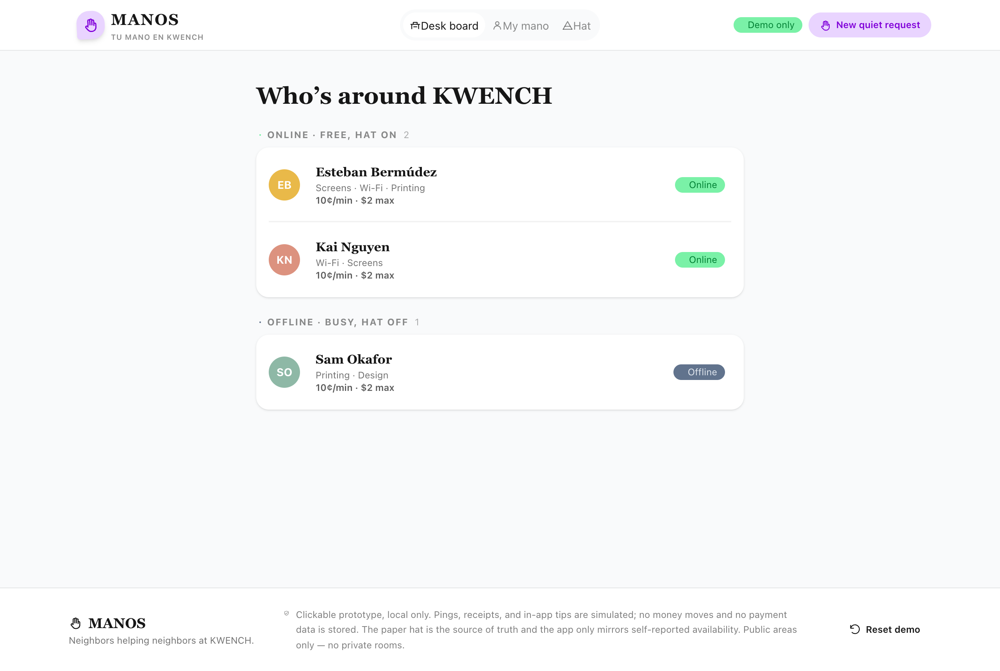
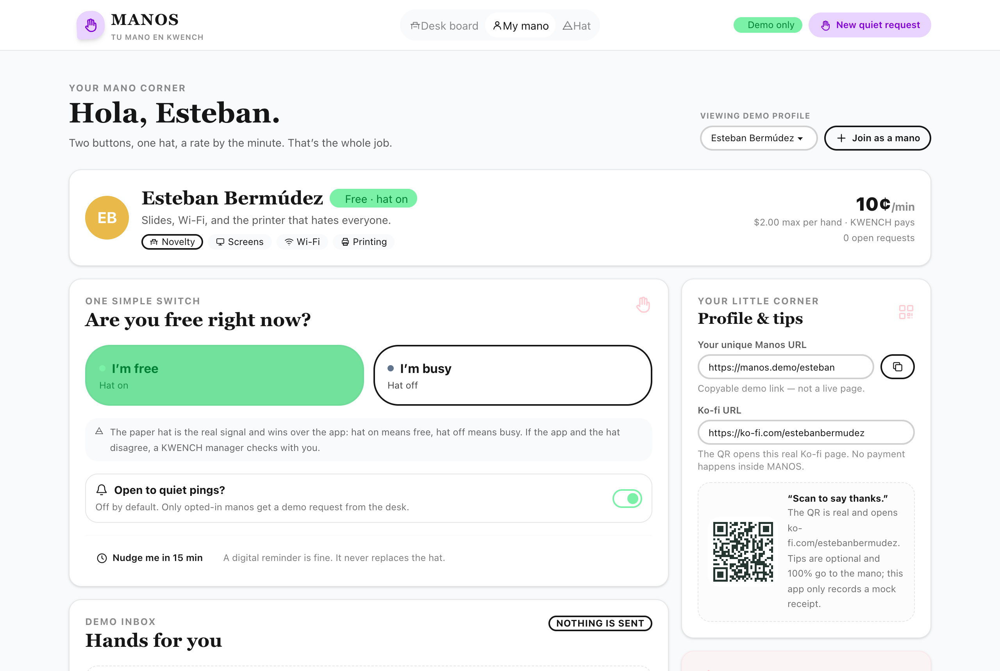
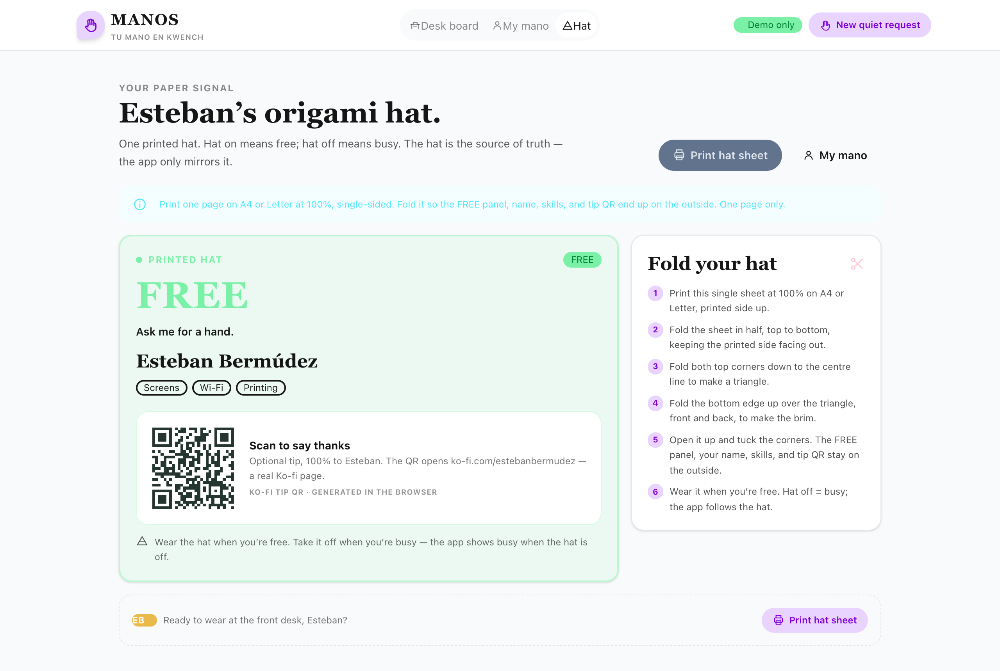

# MANOS — tu mano en KWENCH

A help board for coworking spaces. Members who know how to help become
**manos** (Spanish for "hand"). A front-desk manager like Morgan sees who is
free right now and calls them over.

Built for AI Build Night #002 as a clickable prototype.

**Live demo:** https://esteban-bermudez.github.io/manos/

## Why it exists

At 1:55 p.m., a member's slides won't show in the workshop room. The
manager needs someone now, without interrupting the whole space, chasing
people through group chats, or waiting on replies.

MANOS gets that person to the desk faster:

- The manager sees a list of manos, **online first**.
- Clicking a name calls that person over. There is no ping, no queue, and no
  waiting for a reply.
- Each mano sets their own availability, skills, and rate.

## The paper hat: a supplement to MANOS

The app is the main tool. The paper hat is the physical version of the same
signal, and it makes response faster still.

- **Hat on = free. Hat off = busy.**
- A manager can **scan the room** and see who is wearing a hat. No device,
  no login, and no ping. The hat does the first step of the search before
  the app is opened.
- The app mirrors the hat. The hat is the source of truth. If the app and the
  hat disagree, the manager checks in person.

Each mano can print their own hat from the **Hat** tab. It shows:

- their **name**
- a **Ko-fi QR code** for an optional thank-you tip, visible when folded
- what they **help with**, as skill categories (Screens, Wi-Fi, Printing,
  Design)

Fold instructions are on the same page.

## Pages

| Tab   | Who uses it     | What it does |
|-------|-----------------|--------------|
| Desk  | KWENCH manager  | List of manos, online first, then offline. Click a name to call them over. Each row shows skills and rate. |
| Mano  | The helper      | Set I'm free / I'm busy, ping opt-in, skills, rate, Ko-fi link, complete a hand, and tip QR. |
| Hat   | The helper      | Print your hat with name, QR, skill categories, and fold instructions. |

### Screenshots

| Desk (manager) | Mano (helper) | Hat (printable) |
|----------------|---------------|-----------------|
|  |  |  |

## Money

- KWENCH pays the mano **10¢ per minute, capped at $2 per hand**.
- The member pays nothing.
- An optional tip goes 100% to the mano through their Ko-fi.

These are demo numbers. Nothing is charged in the app.

## Run it

Requires [mise](https://mise.jdx.dev). Bun is pinned in `mise.toml`.

```bash
mise install
bun install
bun run dev        # local dev server
bun run build      # writes dist/index.html
open dist/index.html
```

`dist/index.html` is a single self-contained file. It works from disk with no
server.

## Stack

- Bun, React 19, Vite 7
- Tailwind CSS 4 with daisyUI 5 (`pastel` theme)
- `qrcode` for in-browser QR codes
- `vite-plugin-singlefile` for one static HTML build

## Demo notes

- Everything is local. State lives in `localStorage`. Use **Reset demo** in
  the footer to start over.
- Payments, pings, and call-overs are simulated. No money moves and no
  notifications are sent.
- The Ko-fi QR is real. Scanning it opens the Ko-fi URL set for the mano.
- Public areas only. No private rooms and no stored payment data.

## Status

Prototype for a one-hour event. Not production software.

## Support

If this helped, you can [buy me a coffee on Ko-fi](https://ko-fi.com/estebanbermudez).
